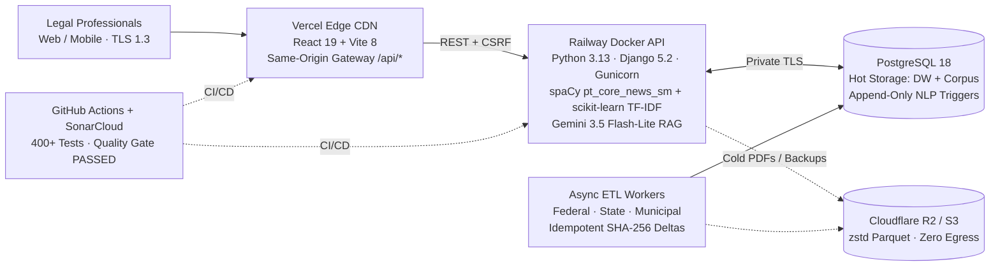

# Cloud Hosting, Multi-Sphere Scalability & 36-Month FinOps Plan

**Decision date:** November 25, 2026  
**Status:** Adopted for production delivery and 36-month support proposal (supersedes [RENDER-HOSTING-RATIONALE.md](../design/RENDER-HOSTING-RATIONALE.md))  
**Executive PDF (PT-BR):** [DatumLex_Plano_Arquitetura_Escalabilidade_Custos_Suporte_v3.pdf](../presentation/DatumLex_Plano_Arquitetura_Escalabilidade_Custos_Suporte_v3.pdf)

---

## 1. Production Architecture Overview

DatumLex runs on an open, three-tier cloud topology engineered for **zero vendor lock-in**, low operating cost, and full portability via standard Docker containers and PostgreSQL 18:

### Active Production Services

| Service | Platform | Configuration | Current Production State |
|---|---|---|---|
| `datumlex-core` | **Vercel** | Global CDN + Serverless Gateway (`/api/gateway.js`) | Live at `https://datumlex-core.vercel.app/` |
| `datumlex-api-real` | **Railway** | Docker (Python 3.13, Django 5.2, Gunicorn, `spaCy`, `scikit-learn`) | Zero-sleep production API (`/api/health/` HTTP 200) |
| `datumlex-db` | **Railway Postgres** | Managed PostgreSQL 18 (TLS, dedicated database) | **~75 MB** holding **32,000+ real official records** across 9 courts |
| CI/CD & Quality | **GitHub Actions + SonarCloud** | Linux + Windows runners + public SonarCloud project | Quality Gate **PASSED** (`0 Bugs`, `0 Vulnerabilities`) |

---

## 2. Why We Migrated from Render Free to Vercel + Railway

In October 2026, an initial prototype ran on Render Free. Before Sprint 3 delivery, the team migrated to **Vercel + Railway** to eliminate three production blockers:
1. **No 15-minute idle sleep:** eliminates cold-start timeouts during demonstrations and professional usage.
2. **Durable PostgreSQL 18:** removes Render Free's 30-day database expiration and 1 GB ceiling.
3. **Full Docker & memory headroom:** comfortably runs `spaCy (pt_core_news_sm)` and `scikit-learn` TF-IDF vectorization in CPU memory alongside Gunicorn workers.

---

## 3. Lowest-Cost Multi-Sphere Scalability Strategy (Federal, State & Municipal)

To support expansion across **all Brazilian governmental spheres over time — including the municipal sphere (5,570 municipalities)** — at the lowest possible cost, DatumLex separates ingestion, hot indexing, and cold storage:

| Governmental Sphere | Official Sources & Open Aggregators | Ingested Content | Low-Cost Strategy |
|---|---|---|---|
| **Federal & Superior Courts** | DataJud/CNJ, STJ, STF, TRF1–TRF6, TST, Pangea/BNP, Senado (RIL), Planalto / LexML | Cases, TPU movements, rulings, binding theses, federal statutes, open doctrine | Incremental cursor-based API deltas + `SHA-256` deduplication |
| **State & District Courts** | TJDFT (active) + 26 State Courts (TJs), DJEN / Comunica PJe, State Gazettes | 1st/2nd instance rulings, appellate panels, IRDR/IAC, state legislation | Shared DataJud/DJEN connector + PostgreSQL partitioning by `(sphere, court, year)` |
| **Municipal Sphere** *(5,570 municipalities)* | **Querido Diário (Open Knowledge Brasil)**, **LexML**, DOM-e municipal consortia (AMM, FECAM, AMUNES), Municipal Legislation Portals, Municipal Tax Courts via DataJud | Organic Laws, Municipal Tax Codes, decrees, normative acts, municipal attorney opinions, municipal tax executions | Demand-driven 3-wave rollout (Capitals/Metro → >100k pop. → on-demand within 48h); leverages open aggregators instead of maintaining 5,570 custom scrapers |
| **Administrative & Audit** | TCU, TCEs, TCMs, CARF | Administrative rulings, tax board precedents, audit court decisions | Pluggable on-demand connectors with zero core schema changes |

### Six FinOps Engineering Pillars
1. **CPU-only real NLP (`R$ 0/query`):** `spaCy` + `scikit-learn` TF-IDF/Cosine run on commodity CPUs, avoiding US\$ 300–1,500/month GPU servers.
2. **Lean RAG (`Gemini 3.5 Flash-Lite`):** LLM is invoked only on explicit chat queries over pre-filtered evidence packets.
3. **Hot/Cold Storage Split:** structured metadata and summaries stay hot in PostgreSQL; full texts and raw PDFs compress (`zstd`/Parquet) into **Cloudflare R2** (US\$ 0.015/GB/month, **zero egress fees**).
4. **Off-Peak Batch ETL:** asynchronous workers ingest only new deltas overnight without degrading API latency.
5. **Native PostgreSQL Partitioning & GIN Indexes (`pg_trgm` / `tsvector`):** avoids separate Elasticsearch or paid vector databases.
6. **Seamless PaaS → Dedicated VPS Transition:** because the stack is 100% Docker + PostgreSQL, scaling beyond PaaS pricing moves cleanly to ARM/x86 VPS (Hetzner / Oracle ARM / Lightsail) + R2, cutting 36-month costs by **up to 75%** compared to hyperscalers.

---

## 4. 36-Month Cost Projection & Alternatives (Ref: US\$ 1.00 = R\$ 5.80)

| Phase | Horizon | Target Infrastructure & Scope | Monthly (US\$) | Monthly (R\$) | 12-Month Subtotal (R\$) |
|---|---|---|---:|---:|---:|
| **Phase 1 — Initial** | Months 1–12 | Vercel + Railway (API/NLP + Postgres 18 up to 5 GB) + Gemini Flash-Lite + R2 Backups + SonarCloud *(9 courts + municipal pilot)* | US\$ 25–40 | R\$ 145–232 | R\$ 1,740–2,784 |
| **Phase 2 — National** | Months 13–24 | Vercel + Railway Pro / 4 vCPU 8 GB VPS + Partitioned Postgres (up to 50 GB) + ETL Workers + R2 (100 GB cold) *(27 TJs + 6 TRFs + capitals)* | US\$ 65–100 | R\$ 377–580 | R\$ 4,524–6,960 |
| **Phase 3 — Multi-Sphere** | Months 25–36 | Dedicated ARM/x86 VPS (8 vCPU / 16–32 GB RAM) + Postgres + Off-site Replica + R2 (300–500 GB cold) *(Federal + State + expanded Municipal)* | US\$ 120–185 | R\$ 696–1,073 | R\$ 8,352–12,876 |
| **36-Month Total** | **3 Years** | **Full progressive cloud infrastructure** | **US\$ 2,520–3,900** | **Avg US\$ 70–108** | **R\$ 14,616–22,620** |

> **Academic Development Transparency Note:** The projection above represents sustainable commercial operation over 36 months. During the academic semester at Fatec SJC, the LegacyTech team operated on free/academic tiers (Vercel Hobby, Railway, Google AI Studio, GitHub, and SonarCloud Public), delivering the complete platform at zero direct financial cost.

### Alternatives Evaluated
- **Render Free / Starter (v2.0 draft):** rejected for production due to 15-minute sleep and 30-day free DB deletion.
- **Vercel + Railway → VPS + Cloudflare R2 (Adopted):** ~75% cheaper than managed hyperscalers, zero egress fees, 100% Docker-portable.
- **Managed Hyperscalers (AWS RDS + ECS / GCP / Azure):** viable enterprise option if mandated by client compliance, at 3×–5× higher cost (US\$ 12,000–22,000 / 36 months).
- **GPU NLP / Per-Document Paid LLM Indexing:** rejected as financially unviable at municipal/national scale (US\$ 18,000+ / 36 months).

---

## 5. 36-Month Infrastructure Ownership, SLA & Client Handover

- **Provider Ownership (Months 1–36):** The LegacyTech / supplier team remains fully responsible for cloud hosting, monitoring, security patches, backups, and cost governance throughout the 36-month support term.
- **Client Takeover Option (Handover):** At the end of the 36 months (or earlier with 30 days' notice), the client company may assume 100% ownership of accounts, repositories, Docker images, encrypted PostgreSQL dumps, documented environment configurations, and operational runbooks.
- **Recovery Targets:** Daily encrypted off-site backups (30-day retention), quarterly isolated restore drills, **RPO ≤ 24 hours**, **RTO ≤ 2 business days** (support window: Mon–Fri, 18:00–22:00 BRT; P1–P4 SLA tracked via GitHub Issues).
