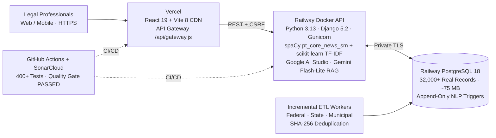

# Cloud Hosting, Multi-Sphere Scalability & 36-Month Cost Plan

**Decision date:** November 25, 2026  
**Status:** Adopted for production delivery and 36-month support proposal (supersedes [RENDER-HOSTING-RATIONALE.md](../design/RENDER-HOSTING-RATIONALE.md))  
**Executive PDF (PT-BR):** [DatumLex_Plano_Arquitetura_Escalabilidade_Custos_Suporte_v3.pdf](../presentation/DatumLex_Plano_Arquitetura_Escalabilidade_Custos_Suporte_v3.pdf)

---

## 1. Production Architecture Overview

DatumLex runs on an open, three-tier cloud topology (**Vercel + Railway + Google AI Studio**) built on standard Docker containers and PostgreSQL 18, ensuring zero vendor lock-in and full portability:

### Active Services

| Service | Platform | Configuration |
|---|---|---|
| `datumlex-core` | **Vercel** | React 19 / Vite 8 static CDN + Same-Origin Gateway (`/api/gateway.js`), live at `https://datumlex-core.vercel.app/` |
| `datumlex-api-real` | **Railway** | Dockerized Django 5.2 / Gunicorn API with `spaCy 3.8 (pt_core_news_sm)`, `scikit-learn 1.9` TF-IDF/Cosine, and Gemini RAG |
| `datumlex-db` | **Railway Postgres** | Managed PostgreSQL 18 (TLS, ~75 MB) holding **32,000+ real official records** across 9 courts |
| CI/CD & Quality | **GitHub Actions + SonarCloud** | 400+ automated tests (Linux + Windows) + public SonarCloud Quality Gate **PASSED** (`0 Bugs`, `0 Vulnerabilities`) |

---

## 2. Lowest-Cost Multi-Sphere Scalability (Federal, State & Municipal)

To scale across **all Brazilian governmental spheres over time — including the municipal sphere (5,570 municipalities)** — at minimum cost:

| Sphere | Official Sources & Open Aggregators | Low-Cost Scaling Approach |
|---|---|---|
| **Federal & Superior** | DataJud/CNJ, STJ, STF, TRF1–6, TST, Pangea/BNP, Senado (RIL), LexML/Planalto | Incremental cursor-based deltas in off-peak windows + `SHA-256` deduplication |
| **State & District** | TJDFT (active) + 26 State Courts (TJs), DJEN / Comunica PJe, jurisprudence portals | Reuses the same DataJud/DJEN connector + PostgreSQL partitioning by sphere, court, and year |
| **Municipal** *(5,570 municipalities)* | **Querido Diário (Open Knowledge Brasil)**, **LexML**, municipal DOM-e consortia, and Municipal Tax Courts via DataJud | Demand-driven activation (capitals and metro regions first, additional municipalities on demand) via open aggregators, avoiding 5,570 individual scrapers |

- **CPU-only NLP (`R$ 0/query`):** `spaCy` + `scikit-learn` run directly on the API CPU with zero GPU cost.
- **On-demand RAG:** `gemini-3.5-flash-lite` (Google AI Studio) is called only when users send chat questions, over pre-filtered SQL results.

---

## 3. Direct Platform Costs (Vercel, Railway & Google AI Studio)

Reference exchange rate: `US$ 1.00 = R$ 5.80`.

| Platform | Covered Resources | Monthly (US\$) | Monthly (R\$) | 36 Months (R\$) |
|---|---|---:|---:|---:|
| **Vercel** | Frontend React/Vite CDN + API Gateway (`Hobby` free or `Pro` US\$ 20/mo for commercial team) | US\$ 0–20 | R\$ 0–116 | R\$ 0–4,176 |
| **Railway** | Backend Django/spaCy (Docker) + PostgreSQL 18 (`Hobby` US\$ 5/mo up to `Pro` US\$ 20/mo as data grows) | US\$ 5–20 | R\$ 29–116 | R\$ 1,044–4,176 |
| **Google AI Studio (Gemini API)** | `gemini-3.5-flash-lite` RAG synthesis (free tier up to pay-as-you-go token usage) | US\$ 0–5 | R\$ 0–29 | R\$ 0–1,044 |
| **Total Platform Infrastructure** | **Lean operation → Expanded multi-sphere operation** | **US\$ 5–45** | **R\$ 29–261** | **R\$ 1,044–9,396** |

> **Academic Development Note:** The projection above covers sustainable continuous operation over 36 months. During academic development at Fatec SJC, the team used free/academic tiers (Vercel, Railway, Google AI Studio, GitHub, and SonarCloud Public) with zero direct financial cost.

---

## 4. 36-Month Infrastructure Ownership, SLA & Handover

- **Provider Ownership (36 Months):** The team remains fully responsible for hosting, operation, security updates, and backups throughout the 36-month support term.
- **Client Takeover:** At the end of the 36 months (or earlier with 30 days' notice), the client may assume full ownership of accounts, repositories, Dockerfiles, encrypted PostgreSQL dumps, and operational manuals.
- **SLA & Continuity:** Support window Mon–Fri 18:00–22:00 BRT via GitHub Issues (P1–P4 priorities), daily encrypted off-site backups (30-day retention), quarterly restore drills, **RPO ≤ 24h**, **RTO ≤ 2 business days**.
